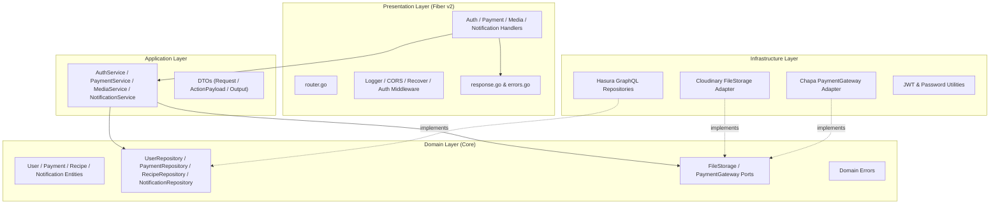

# Clean Architecture Refactor Implementation Plan

> **For agentic workers:** REQUIRED SUB-SKILL: Use superpowers:subagent-driven-development to implement this plan task-by-task. Steps use checkbox (`- [ ]`) syntax for tracking.

**Goal:** Refactor the `food-recipe` backend to Clean Architecture based on `DSLServer`, replacing Chi with Fiber v2 and separating the codebase into distinct Domain, Application, Infrastructure, and Presentation layers.

**Architecture:** 
The application adopts strict Clean Architecture layer separation. Domain contains core entities, repository interfaces, external port definitions, and domain errors without external dependencies. Application coordinates use cases through services and DTOs. Infrastructure provides implementations for persistence (Hasura GraphQL client), storage (Cloudinary), payment (Chapa), and security (JWT/bcrypt). Presentation hosts Fiber v2 handlers, middleware, routes, and response mappers. `cmd/app/main.go` wires dependencies and starts the server with graceful shutdown.

**Architecture Diagram:**



**Tech Stack:** 
- Go 1.24
- Fiber v2 (`github.com/gofiber/fiber/v2`)
- Hasura GraphQL Client (`github.com/hasura/go-graphql-client`)
- Cloudinary SDK (`github.com/cloudinary/cloudinary-go/v2`)
- Chapa Go SDK (`github.com/Chapa-Et/chapa-go`)
- Golang JWT (`github.com/golang-jwt/jwt/v5`)
- Google UUID (`github.com/google/uuid`)
- Crypto (`golang.org/x/crypto/bcrypt`)

## Global Constraints
- Must maintain 100% backward compatibility for Hasura Action payloads and return shapes.
- Must preserve environment variable names: `PORT`, `HASURA_URL`, `HASURA_GRAPHQL_ADMIN_SECRET`, `HASURA_JWT_SECRET`, `CLOUDINARY_CLOUD_NAME`, `CLOUDINARY_API_KEY`, `CLOUDINARY_API_SECRET`, `CHAPA_SECRET_KEY`, `CALLBACK_URL`, `ALLOWED_ORIGINS`.
- Zero domain dependencies on web frameworks (`fiber`, `chi`, `http`) or concrete database clients.

---

### Task 1: Dependencies and Configuration Layer

**Files:**
- Modify: `go.mod`
- Create: `internal/config/config.go`
- Test: `internal/config/config_test.go`

**Interfaces:**
- Produces: `config.Config`, `config.LoadConfig() (*Config, error)`

- [ ] **Step 1: Write test for Config loading**

Create `internal/config/config_test.go`:
```go
package config_test

import (
	"os"
	"testing"

	"go/food-recipe/internal/config"
)

func TestLoadConfig(t *testing.T) {
	os.Setenv("PORT", "9000")
	os.Setenv("HASURA_URL", "http://localhost:8080/v1/graphql")
	os.Setenv("HASURA_GRAPHQL_ADMIN_SECRET", "secret")
	os.Setenv("HASURA_JWT_SECRET", "jwtsecret123456789012345678901234")
	os.Setenv("CLOUDINARY_CLOUD_NAME", "cloud")
	os.Setenv("CLOUDINARY_API_KEY", "key")
	os.Setenv("CLOUDINARY_API_SECRET", "secret")
	os.Setenv("CHAPA_SECRET_KEY", "chapa_key")

	cfg, err := config.LoadConfig()
	if err != nil {
		t.Fatalf("expected no error, got %v", err)
	}

	if cfg.App.Port != "9000" {
		t.Errorf("expected port 9000, got %s", cfg.App.Port)
	}
	if cfg.Hasura.URL != "http://localhost:8080/v1/graphql" {
		t.Errorf("expected hasura url, got %s", cfg.Hasura.URL)
	}
}
```

- [ ] **Step 2: Add Fiber v2 dependency and verify test fails**

Run:
```powershell
go get github.com/gofiber/fiber/v2
go test ./internal/config/...
```
Expected: FAIL (package does not exist yet)

- [ ] **Step 3: Implement Config struct and Loader**

Create `internal/config/config.go`:
```go
package config

import (
	"os"

	"github.com/joho/godotenv"
)

type AppConfig struct {
	Port           string
	AllowedOrigins string
	CallbackURL    string
}

type HasuraConfig struct {
	URL         string
	AdminSecret string
}

type JWTConfig struct {
	Secret string
}

type CloudinaryConfig struct {
	CloudName string
	APIKey    string
	APISecret string
}

type ChapaConfig struct {
	SecretKey string
}

type Config struct {
	App        AppConfig
	Hasura     HasuraConfig
	JWT        JWTConfig
	Cloudinary CloudinaryConfig
	Chapa      ChapaConfig
}

var CFG *Config

func LoadConfig() (*Config, error) {
	_ = godotenv.Load()

	port := os.Getenv("PORT")
	if port == "" {
		port = "8000"
	}

	origins := os.Getenv("ALLOWED_ORIGINS")
	if origins == "" {
		origins = "*"
	}

	cfg := &Config{
		App: AppConfig{
			Port:           port,
			AllowedOrigins: origins,
			CallbackURL:    os.Getenv("CALLBACK_URL"),
		},
		Hasura: HasuraConfig{
			URL:         os.Getenv("HASURA_URL"),
			AdminSecret: os.Getenv("HASURA_GRAPHQL_ADMIN_SECRET"),
		},
		JWT: JWTConfig{
			Secret: os.Getenv("HASURA_JWT_SECRET"),
		},
		Cloudinary: CloudinaryConfig{
			CloudName: os.Getenv("CLOUDINARY_CLOUD_NAME"),
			APIKey:    os.Getenv("CLOUDINARY_API_KEY"),
			APISecret: os.Getenv("CLOUDINARY_API_SECRET"),
		},
		Chapa: ChapaConfig{
			SecretKey: os.Getenv("CHAPA_SECRET_KEY"),
		},
	}

	CFG = cfg
	return cfg, nil
}
```

- [ ] **Step 4: Run test to verify it passes**

Run: `go test ./internal/config/...`
Expected: PASS

- [ ] **Step 5: Commit changes**

```bash
git add go.mod go.sum internal/config
git commit -m "feat(config): add typed configuration and fiber v2 dependency"
```

---

### Task 2: Domain Layer Entities, Errors, Repositories & Ports

**Files:**
- Create: `internal/domain/entities/user.go`
- Create: `internal/domain/entities/payment.go`
- Create: `internal/domain/entities/recipe.go`
- Create: `internal/domain/entities/notification.go`
- Create: `internal/domain/errors/errors.go`
- Create: `internal/domain/repositories/user_repository.go`
- Create: `internal/domain/repositories/payment_repository.go`
- Create: `internal/domain/repositories/recipe_repository.go`
- Create: `internal/domain/repositories/notification_repository.go`
- Create: `internal/domain/ports/file_storage.go`
- Create: `internal/domain/ports/payment_gateway.go`
- Test: `internal/domain/entities/entities_test.go`

**Interfaces:**
- Produces: Domain entity structs, error definitions, and interface contracts.

- [ ] **Step 1: Write entities test**

Create `internal/domain/entities/entities_test.go`:
```go
package entities_test

import (
	"testing"

	"github.com/google/uuid"
	"go/food-recipe/internal/domain/entities"
)

func TestUserEntity(t *testing.T) {
	id := uuid.New()
	u := entities.User{
		ID:        id,
		Email:     "test@example.com",
		Username:  "tester",
		FirstName: "Test",
		LastName:  "User",
	}
	if u.FullName() != "Test User" {
		t.Errorf("expected 'Test User', got '%s'", u.FullName())
	}
}
```

- [ ] **Step 2: Implement Domain Entities**

Create `internal/domain/entities/user.go`:
```go
package entities

import "github.com/google/uuid"

type User struct {
	ID        uuid.UUID
	Email     string
	Username  string
	FirstName string
	LastName  string
	Password  string
	AvatarURL string
}

func (u User) FullName() string {
	if u.FirstName == "" && u.LastName == "" {
		return u.Username
	}
	if u.FirstName != "" && u.LastName != "" {
		return u.FirstName + " " + u.LastName
	}
	return u.FirstName + u.LastName
}
```

Create `internal/domain/entities/payment.go`:
```go
package entities

import "github.com/google/uuid"

type Transaction struct {
	ID          uuid.UUID
	UserID      uuid.UUID
	RecipeID    int
	TrxRef      string
	Amount      float64
	Currency    string
	CheckoutURL string
}

type Payment struct {
	ID          string
	UserID      uuid.UUID
	RecipeID    int
	TxRef       string
	Amount      float64
	CheckoutURL string
	Currency    string
	Status      string
}
```

Create `internal/domain/entities/recipe.go`:
```go
package entities

type RecipeImage struct {
	ID          string
	RecipeID    int
	ImageURL    string
	IsThumbnail bool
}
```

Create `internal/domain/entities/notification.go`:
```go
package entities

import "github.com/google/uuid"

type Notification struct {
	ID          uuid.UUID
	UserID      uuid.UUID
	Message     string
	InitiatorID uuid.UUID
}
```

- [ ] **Step 3: Implement Domain Errors**

Create `internal/domain/errors/errors.go`:
```go
package errors

import "errors"

var (
	ErrUserNotFound        = errors.New("user not found")
	ErrUserAlreadyExists   = errors.New("email already registered")
	ErrUsernameTaken       = errors.New("username already taken")
	ErrInvalidCredentials  = errors.New("invalid credentials")
	ErrUnauthorized        = errors.New("unauthorized")
	ErrInvalidInput        = errors.New("invalid input")
	ErrTransactionNotFound = errors.New("transaction not found")
	ErrPaymentFailed       = errors.New("payment failed")
	ErrServiceUnavailable  = errors.New("service temporarily unavailable")
)
```

- [ ] **Step 4: Implement Domain Repository and Port Interfaces**

Create `internal/domain/repositories/user_repository.go`:
```go
package repositories

import (
	"context"

	"github.com/google/uuid"
	"go/food-recipe/internal/domain/entities"
)

type UserRepository interface {
	GetByID(ctx context.Context, id uuid.UUID) (*entities.User, error)
	GetByEmail(ctx context.Context, email string) (*entities.User, error)
	GetByUsername(ctx context.Context, username string) (*entities.User, error)
	Create(ctx context.Context, user *entities.User) (*entities.User, error)
	UpdateAvatar(ctx context.Context, userID uuid.UUID, avatarURL string) error
}
```

Create `internal/domain/repositories/payment_repository.go`:
```go
package repositories

import (
	"context"

	"go/food-recipe/internal/domain/entities"
)

type PaymentRepository interface {
	CreateTransaction(ctx context.Context, tx *entities.Transaction) error
	GetTransactionByRef(ctx context.Context, txRef string) (*entities.Transaction, error)
	CreatePayment(ctx context.Context, payment *entities.Payment) error
}
```

Create `internal/domain/repositories/recipe_repository.go`:
```go
package repositories

import (
	"context"

	"github.com/google/uuid"
	"go/food-recipe/internal/domain/entities"
)

type RecipeRepository interface {
	GetCreatorFromLikeID(ctx context.Context, likeID uuid.UUID) (recipeOwnerID uuid.UUID, likerUsername string, err error)
	AddRecipeImage(ctx context.Context, img *entities.RecipeImage) error
}
```

Create `internal/domain/repositories/notification_repository.go`:
```go
package repositories

import (
	"context"

	"go/food-recipe/internal/domain/entities"
)

type NotificationRepository interface {
	Create(ctx context.Context, n *entities.Notification) error
}
```

Create `internal/domain/ports/file_storage.go`:
```go
package ports

import "context"

type FileStorage interface {
	UploadBase64Image(ctx context.Context, base64Data, publicID, folder string) (string, error)
}
```

Create `internal/domain/ports/payment_gateway.go`:
```go
package ports

import "context"

type PaymentInitParams struct {
	Amount      float64
	Currency    string
	FirstName   string
	LastName    string
	Email       string
	TxRef       string
	Phone       string
	CallbackURL string
}

type PaymentInitResult struct {
	CheckoutURL string
	TxRef       string
	Status      string
}

type PaymentVerifyResult struct {
	Status  string
	Message string
}

type PaymentGateway interface {
	Initialize(ctx context.Context, params PaymentInitParams) (*PaymentInitResult, error)
	Verify(ctx context.Context, txRef string) (*PaymentVerifyResult, error)
}
```

- [ ] **Step 5: Run tests and verify**

Run: `go test ./internal/domain/...`
Expected: PASS

- [ ] **Step 6: Commit changes**

```bash
git add internal/domain
git commit -m "feat(domain): define entities, repositories, ports and domain errors"
```

---

### Task 3: Infrastructure Security, Storage & Payment Adapters

**Files:**
- Create: `internal/infrastructure/security/jwt.go`
- Create: `internal/infrastructure/security/password.go`
- Create: `internal/infrastructure/storage/cloudinary/storage.go`
- Create: `internal/infrastructure/payment/chapa/gateway.go`
- Test: `internal/infrastructure/security/security_test.go`

**Interfaces:**
- Produces: `security.TokenManager`, `security.PasswordHasher`, `storage.CloudinaryStorage`, `chapa.Gateway`

- [ ] **Step 1: Write test for Security functions**

Create `internal/infrastructure/security/security_test.go`:
```go
package security_test

import (
	"testing"

	"go/food-recipe/internal/infrastructure/security"
)

func TestPasswordHashingAndVerification(t *testing.T) {
	raw := "supersecret123"
	hash, err := security.HashPassword(raw)
	if err != nil {
		t.Fatalf("unexpected error hashing: %v", err)
	}

	if err := security.ComparePassword(hash, raw); err != nil {
		t.Fatalf("expected valid password comparison, got: %v", err)
	}

	if err := security.ComparePassword(hash, "wrongpass"); err == nil {
		t.Fatalf("expected error on wrong password, got nil")
	}
}

func TestJWTGenerationAndVerification(t *testing.T) {
	secret := "secret-jwt-key-with-sufficient-length-12345"
	userID := "00000000-0000-0000-0000-000000000001"
	email := "user@example.com"

	token, err := security.GenerateHasuraJWT(userID, email, secret)
	if err != nil {
		t.Fatalf("failed to generate JWT: %v", err)
	}

	claims, err := security.VerifyHasuraJWT(token, secret)
	if err != nil {
		t.Fatalf("failed to verify JWT: %v", err)
	}

	if claims["sub"] != userID {
		t.Errorf("expected sub %s, got %v", userID, claims["sub"])
	}
}
```

- [ ] **Step 2: Implement Security package**

Create `internal/infrastructure/security/password.go`:
```go
package security

import "golang.org/x/crypto/bcrypt"

const defaultBcryptCost = 12

func HashPassword(password string) (string, error) {
	hash, err := bcrypt.GenerateFromPassword([]byte(password), defaultBcryptCost)
	if err != nil {
		return "", err
	}
	return string(hash), nil
}

func ComparePassword(hashedPassword, password string) error {
	return bcrypt.CompareHashAndPassword([]byte(hashedPassword), []byte(password))
}
```

Create `internal/infrastructure/security/jwt.go`:
```go
package security

import (
	"fmt"
	"time"

	jwt "github.com/golang-jwt/jwt/v5"
)

func GenerateHasuraJWT(userID, email, secret string) (string, error) {
	if secret == "" {
		return "", fmt.Errorf("jwt secret is empty")
	}

	claims := jwt.MapClaims{
		"sub":   userID,
		"email": email,
		"https://hasura.io/jwt/claims": map[string]interface{}{
			"x-hasura-allowed-roles": []string{"user", "anon", "admin"},
			"x-hasura-default-role":  "user",
			"x-hasura-user-id":       userID,
		},
		"exp": time.Now().Add(24 * time.Hour).Unix(),
	}

	token := jwt.NewWithClaims(jwt.SigningMethodHS256, claims)
	return token.SignedString([]byte(secret))
}

func VerifyHasuraJWT(tokenStr, secret string) (jwt.MapClaims, error) {
	if secret == "" {
		return nil, fmt.Errorf("jwt secret is empty")
	}

	token, err := jwt.ParseWithClaims(tokenStr, jwt.MapClaims{}, func(t *jwt.Token) (interface{}, error) {
		if _, ok := t.Method.(*jwt.SigningMethodHMAC); !ok {
			return nil, fmt.Errorf("unexpected signing method: %v", t.Header["alg"])
		}
		return []byte(secret), nil
	})
	if err != nil {
		return nil, err
	}
	if !token.Valid {
		return nil, fmt.Errorf("invalid token")
	}

	claims, ok := token.Claims.(jwt.MapClaims)
	if !ok {
		return nil, fmt.Errorf("invalid token claims")
	}

	if expRaw, ok := claims["exp"]; ok {
		var expUnix int64
		switch exp := expRaw.(type) {
		case float64:
			expUnix = int64(exp)
		case int64:
			expUnix = exp
		}
		if expUnix > 0 && expUnix < time.Now().Unix() {
			return nil, fmt.Errorf("token expired")
		}
	}

	return claims, nil
}
```

- [ ] **Step 3: Implement Cloudinary Storage Adapter**

Create `internal/infrastructure/storage/cloudinary/storage.go`:
```go
package cloudinary

import (
	"context"
	"fmt"

	"github.com/cloudinary/cloudinary-go/v2"
	"github.com/cloudinary/cloudinary-go/v2/api/uploader"
	"go/food-recipe/internal/config"
	"go/food-recipe/internal/domain/ports"
)

type CloudinaryStorage struct {
	client *cloudinary.Cloudinary
}

func NewCloudinaryStorage(cfg config.CloudinaryConfig) (*CloudinaryStorage, error) {
	if cfg.CloudName == "" || cfg.APIKey == "" || cfg.APISecret == "" {
		return &CloudinaryStorage{client: nil}, nil
	}

	client, err := cloudinary.NewFromParams(cfg.CloudName, cfg.APIKey, cfg.APISecret)
	if err != nil {
		return nil, fmt.Errorf("failed to init cloudinary: %w", err)
	}

	return &CloudinaryStorage{client: client}, nil
}

var _ ports.FileStorage = (*CloudinaryStorage)(nil)

func (s *CloudinaryStorage) UploadBase64Image(ctx context.Context, base64Data, publicID, folder string) (string, error) {
	if s.client == nil {
		return "", fmt.Errorf("cloudinary client not initialized")
	}

	result, err := s.client.Upload.Upload(ctx, base64Data, uploader.UploadParams{
		PublicID:     publicID,
		Folder:       folder,
		ResourceType: "image",
	})
	if err != nil {
		return "", fmt.Errorf("failed to upload image: %w", err)
	}

	return result.SecureURL, nil
}
```

- [ ] **Step 4: Implement Chapa Gateway Adapter**

Create `internal/infrastructure/payment/chapa/gateway.go`:
```go
package chapa

import (
	"context"
	"fmt"

	chapa "github.com/Chapa-Et/chapa-go"
	"github.com/shopspring/decimal"
	"go/food-recipe/internal/config"
	"go/food-recipe/internal/domain/ports"
)

type ChapaGateway struct {
	client *chapa.Chapa
}

func NewChapaGateway(cfg config.ChapaConfig) *ChapaGateway {
	return &ChapaGateway{
		client: chapa.New(),
	}
}

var _ ports.PaymentGateway = (*ChapaGateway)(nil)

func (g *ChapaGateway) Initialize(ctx context.Context, params ports.PaymentInitParams) (*ports.PaymentInitResult, error) {
	req := &chapa.PaymentRequest{
		Amount:         decimal.NewFromFloat(params.Amount),
		Currency:       params.Currency,
		FirstName:      params.FirstName,
		LastName:       params.LastName,
		Email:          params.Email,
		TransactionRef: params.TxRef,
		Phone:          params.Phone,
		TestMode:       true,
		CallbackURL:    params.CallbackURL,
	}

	api := chapa.API(g.client)
	res, err := api.PaymentRequest(req)
	if err != nil {
		return nil, fmt.Errorf("chapa request error: %w", err)
	}

	if res.Status != "success" {
		return nil, fmt.Errorf("chapa payment initialization failed: %s", res.Message)
	}

	return &ports.PaymentInitResult{
		CheckoutURL: res.Data.CheckoutURL,
		TxRef:       params.TxRef,
		Status:      res.Status,
	}, nil
}

func (g *ChapaGateway) Verify(ctx context.Context, txRef string) (*ports.PaymentVerifyResult, error) {
	res, err := g.client.Verify(txRef)
	if err != nil {
		return nil, fmt.Errorf("chapa verify error: %w", err)
	}

	return &ports.PaymentVerifyResult{
		Status:  res.Status,
		Message: res.Message,
	}, nil
}
```

- [ ] **Step 5: Run tests**

Run: `go test ./internal/infrastructure/security/...`
Expected: PASS

- [ ] **Step 6: Commit changes**

```bash
git add internal/infrastructure/security internal/infrastructure/storage internal/infrastructure/payment
git commit -m "feat(infra): add security, cloudinary and chapa adapters"
```

---

### Task 4: Infrastructure Persistence with Hasura GraphQL

**Files:**
- Create: `internal/infrastructure/persistence/hasura/client.go`
- Create: `internal/infrastructure/persistence/hasura/user_repository.go`
- Create: `internal/infrastructure/persistence/hasura/payment_repository.go`
- Create: `internal/infrastructure/persistence/hasura/recipe_repository.go`
- Create: `internal/infrastructure/persistence/hasura/notification_repository.go`

**Interfaces:**
- Produces: `hasura.NewUserRepository`, `hasura.NewPaymentRepository`, `hasura.NewRecipeRepository`, `hasura.NewNotificationRepository` implementing domain repository interfaces.

- [ ] **Step 1: Implement Hasura client wrapper**

Create `internal/infrastructure/persistence/hasura/client.go`:
```go
package hasura

import (
	"net/http"

	graphql "github.com/hasura/go-graphql-client"
	"go/food-recipe/internal/config"
)

type Client struct {
	GQL *graphql.Client
}

func NewClient(cfg config.HasuraConfig) *Client {
	if cfg.URL == "" {
		return &Client{GQL: nil}
	}

	c := graphql.NewClient(cfg.URL, &http.Client{}).
		WithRequestModifier(func(req *http.Request) {
			if cfg.AdminSecret != "" {
				req.Header.Set("x-hasura-admin-secret", cfg.AdminSecret)
			}
		})

	return &Client{GQL: c}
}
```

- [ ] **Step 2: Implement UserRepository**

Create `internal/infrastructure/persistence/hasura/user_repository.go`:
```go
package hasura

import (
	"context"
	"fmt"

	"github.com/google/uuid"
	"go/food-recipe/internal/domain/entities"
	domain_errors "go/food-recipe/internal/domain/errors"
	"go/food-recipe/internal/domain/repositories"
)

type UserRepository struct {
	client *Client
}

func NewUserRepository(client *Client) repositories.UserRepository {
	return &UserRepository{client: client}
}

type GQLUUID uuid.UUID

func (u GQLUUID) GetGraphQLType() string {
	return "uuid"
}

func (r *UserRepository) GetByID(ctx context.Context, id uuid.UUID) (*entities.User, error) {
	if r.client.GQL == nil {
		return nil, domain_errors.ErrServiceUnavailable
	}

	var query struct {
		User struct {
			ID        uuid.UUID `graphql:"id"`
			Email     string    `graphql:"email"`
			Password  string    `graphql:"password"`
			Username  string    `graphql:"username"`
			FirstName string    `graphql:"FirstName"`
			LastName  string    `graphql:"LastName"`
			AvatarURL string    `graphql:"avatar_url"`
		} `graphql:"user_by_pk(id: $id)"`
	}

	vars := map[string]interface{}{"id": GQLUUID(id)}
	if err := r.client.GQL.Query(ctx, &query, vars); err != nil {
		return nil, fmt.Errorf("failed to query user by id: %w", err)
	}

	if query.User.ID == uuid.Nil {
		return nil, domain_errors.ErrUserNotFound
	}

	return &entities.User{
		ID:        query.User.ID,
		Email:     query.User.Email,
		Username:  query.User.Username,
		FirstName: query.User.FirstName,
		LastName:  query.User.LastName,
		Password:  query.User.Password,
		AvatarURL: query.User.AvatarURL,
	}, nil
}

func (r *UserRepository) GetByEmail(ctx context.Context, email string) (*entities.User, error) {
	if r.client.GQL == nil {
		return nil, domain_errors.ErrServiceUnavailable
	}

	var query struct {
		Users []struct {
			ID        uuid.UUID `graphql:"id"`
			Email     string    `graphql:"email"`
			Password  string    `graphql:"password"`
			Username  string    `graphql:"username"`
			FirstName string    `graphql:"FirstName"`
			LastName  string    `graphql:"LastName"`
			AvatarURL string    `graphql:"avatar_url"`
		} `graphql:"user(where: {email: {_eq: $email}})"`
	}

	vars := map[string]interface{}{"email": email}
	if err := r.client.GQL.Query(ctx, &query, vars); err != nil {
		return nil, fmt.Errorf("failed to query user by email: %w", err)
	}

	if len(query.Users) == 0 {
		return nil, domain_errors.ErrUserNotFound
	}

	u := query.Users[0]
	return &entities.User{
		ID:        u.ID,
		Email:     u.Email,
		Username:  u.Username,
		FirstName: u.FirstName,
		LastName:  u.LastName,
		Password:  u.Password,
		AvatarURL: u.AvatarURL,
	}, nil
}

func (r *UserRepository) GetByUsername(ctx context.Context, username string) (*entities.User, error) {
	if r.client.GQL == nil {
		return nil, domain_errors.ErrServiceUnavailable
	}

	var query struct {
		Users []struct {
			ID        uuid.UUID `graphql:"id"`
			Email     string    `graphql:"email"`
			Password  string    `graphql:"password"`
			Username  string    `graphql:"username"`
			FirstName string    `graphql:"FirstName"`
			LastName  string    `graphql:"LastName"`
			AvatarURL string    `graphql:"avatar_url"`
		} `graphql:"user(where: {username: {_eq: $username}})"`
	}

	vars := map[string]interface{}{"username": username}
	if err := r.client.GQL.Query(ctx, &query, vars); err != nil {
		return nil, fmt.Errorf("failed to query user by username: %w", err)
	}

	if len(query.Users) == 0 {
		return nil, domain_errors.ErrUserNotFound
	}

	u := query.Users[0]
	return &entities.User{
		ID:        u.ID,
		Email:     u.Email,
		Username:  u.Username,
		FirstName: u.FirstName,
		LastName:  u.LastName,
		Password:  u.Password,
		AvatarURL: u.AvatarURL,
	}, nil
}

func (r *UserRepository) Create(ctx context.Context, user *entities.User) (*entities.User, error) {
	if r.client.GQL == nil {
		return nil, domain_errors.ErrServiceUnavailable
	}

	var mutation struct {
		InsertUsers struct {
			Returning []struct {
				ID    uuid.UUID `graphql:"id"`
				Email string    `graphql:"email"`
			} `graphql:"returning"`
		} `graphql:"insert_user(objects: {email: $email, password: $password, username: $username, FirstName: $first_name, LastName: $last_name})"`
	}

	vars := map[string]interface{}{
		"email":      user.Email,
		"password":   user.Password,
		"username":   user.Username,
		"first_name": user.FirstName,
		"last_name":  user.LastName,
	}

	if err := r.client.GQL.Mutate(ctx, &mutation, vars); err != nil {
		return nil, fmt.Errorf("failed to insert user: %w", err)
	}

	if len(mutation.InsertUsers.Returning) == 0 {
		return nil, fmt.Errorf("failed to insert user: no records returned")
	}

	created := mutation.InsertUsers.Returning[0]
	user.ID = created.ID
	return user, nil
}

func (r *UserRepository) UpdateAvatar(ctx context.Context, userID uuid.UUID, avatarURL string) error {
	if r.client.GQL == nil {
		return domain_errors.ErrServiceUnavailable
	}

	var mutation struct {
		UpdateUsers struct {
			Returning []struct {
				ID uuid.UUID `graphql:"id"`
			} `graphql:"returning"`
		} `graphql:"update_user(where: {id: {_eq: $id}}, _set: {avatar_url: $avatar_url})"`
	}

	vars := map[string]interface{}{
		"id":         GQLUUID(userID),
		"avatar_url": avatarURL,
	}

	return r.client.GQL.Mutate(ctx, &mutation, vars)
}
```

- [ ] **Step 3: Implement PaymentRepository**

Create `internal/infrastructure/persistence/hasura/payment_repository.go`:
```go
package hasura

import (
	"context"
	"fmt"

	"github.com/google/uuid"
	"go/food-recipe/internal/domain/entities"
	domain_errors "go/food-recipe/internal/domain/errors"
	"go/food-recipe/internal/domain/repositories"
)

type PaymentRepository struct {
	client *Client
}

func NewPaymentRepository(client *Client) repositories.PaymentRepository {
	return &PaymentRepository{client: client}
}

func (r *PaymentRepository) CreateTransaction(ctx context.Context, tx *entities.Transaction) error {
	if r.client.GQL == nil {
		return domain_errors.ErrServiceUnavailable
	}

	var mutation struct {
		InsertTransaction struct {
			Returning []struct {
				ID uuid.UUID `graphql:"id"`
			} `graphql:"returning"`
		} `graphql:"insert_transaction(objects: {trx_ref: $trx_ref, user_id: $user_id, recipe_id: $recipe_id, currency: $currency, amount: $amount, checkout_url: $checkout_url})"`
	}

	vars := map[string]interface{}{
		"user_id":      GQLUUID(tx.UserID),
		"recipe_id":    tx.RecipeID,
		"trx_ref":      tx.TrxRef,
		"checkout_url": tx.CheckoutURL,
		"amount":       tx.Amount,
		"currency":     tx.Currency,
	}

	return r.client.GQL.Mutate(ctx, &mutation, vars)
}

func (r *PaymentRepository) GetTransactionByRef(ctx context.Context, txRef string) (*entities.Transaction, error) {
	if r.client.GQL == nil {
		return nil, domain_errors.ErrServiceUnavailable
	}

	var query struct {
		Transaction []struct {
			TrxRef      string    `graphql:"trx_ref"`
			RecipeId    int       `graphql:"recipe_id"`
			UserId      uuid.UUID `graphql:"user_id"`
			Currency    string    `graphql:"currency"`
			CheckoutUrl string    `graphql:"checkout_url"`
			Amount      float64   `graphql:"amount"`
		} `graphql:"transaction(where: { trx_ref: { _eq: $trx_ref }})"`
	}

	vars := map[string]interface{}{"trx_ref": txRef}
	if err := r.client.GQL.Query(ctx, &query, vars); err != nil {
		return nil, fmt.Errorf("failed to query transaction: %w", err)
	}

	if len(query.Transaction) == 0 {
		return nil, domain_errors.ErrTransactionNotFound
	}

	row := query.Transaction[0]
	return &entities.Transaction{
		TrxRef:      row.TrxRef,
		RecipeID:    row.RecipeId,
		UserID:      row.UserId,
		Currency:    row.Currency,
		CheckoutURL: row.CheckoutUrl,
		Amount:      row.Amount,
	}, nil
}

func (r *PaymentRepository) CreatePayment(ctx context.Context, p *entities.Payment) error {
	if r.client.GQL == nil {
		return domain_errors.ErrServiceUnavailable
	}

	var mutation struct {
		InsertPayment struct {
			Returning []struct {
				ID string `graphql:"id"`
			} `graphql:"returning"`
		} `graphql:"insert_payment(objects: {user_id: $user_id, recipe_id: $recipe_id, tx_ref: $tx_ref, amount: $amount, chapa_checkout_url: $checkout_url, currency: $currency, status: $status})"`
	}

	vars := map[string]interface{}{
		"user_id":      GQLUUID(p.UserID),
		"recipe_id":    p.RecipeID,
		"tx_ref":       p.TxRef,
		"amount":       p.Amount,
		"checkout_url": p.CheckoutURL,
		"currency":     p.Currency,
		"status":       p.Status,
	}

	return r.client.GQL.Mutate(ctx, &mutation, vars)
}
```

- [ ] **Step 4: Implement RecipeRepository and NotificationRepository**

Create `internal/infrastructure/persistence/hasura/recipe_repository.go`:
```go
package hasura

import (
	"context"
	"fmt"

	"github.com/google/uuid"
	"go/food-recipe/internal/domain/entities"
	domain_errors "go/food-recipe/internal/domain/errors"
	"go/food-recipe/internal/domain/repositories"
)

type RecipeRepository struct {
	client *Client
}

func NewRecipeRepository(client *Client) repositories.RecipeRepository {
	return &RecipeRepository{client: client}
}

func (r *RecipeRepository) GetCreatorFromLikeID(ctx context.Context, likeID uuid.UUID) (uuid.UUID, string, error) {
	if r.client.GQL == nil {
		return uuid.Nil, "", domain_errors.ErrServiceUnavailable
	}

	var query struct {
		Like struct {
			ID     uuid.UUID `graphql:"id"`
			Recipe struct {
				UserID string `graphql:"user_id"`
			} `graphql:"recipe"`
			User struct {
				ID       uuid.UUID `graphql:"id"`
				Username string    `graphql:"username"`
			} `graphql:"user"`
		} `graphql:"recipe_like_by_pk(id: $id)"`
	}

	vars := map[string]interface{}{"id": GQLUUID(likeID)}
	if err := r.client.GQL.Query(ctx, &query, vars); err != nil {
		return uuid.Nil, "", fmt.Errorf("failed to query recipe like: %w", err)
	}

	ownerID, err := uuid.Parse(query.Like.Recipe.UserID)
	if err != nil {
		return uuid.Nil, "", fmt.Errorf("invalid recipe owner id: %w", err)
	}

	return ownerID, query.Like.User.Username, nil
}

func (r *RecipeRepository) AddRecipeImage(ctx context.Context, img *entities.RecipeImage) error {
	if r.client.GQL == nil {
		return domain_errors.ErrServiceUnavailable
	}

	var mutation struct {
		InsertRecipeImage struct {
			Returning []struct {
				ID string `graphql:"id"`
			} `graphql:"returning"`
		} `graphql:"insert_recipe_image(objects: {img_url: $img_url, recipe_id: $recipe_id, is_thumbnail: $is_thumbnail})"`
	}

	vars := map[string]interface{}{
		"recipe_id":    img.RecipeID,
		"img_url":      img.ImageURL,
		"is_thumbnail": img.IsThumbnail,
	}

	return r.client.GQL.Mutate(ctx, &mutation, vars)
}
```

Create `internal/infrastructure/persistence/hasura/notification_repository.go`:
```go
package hasura

import (
	"context"

	"github.com/google/uuid"
	"go/food-recipe/internal/domain/entities"
	domain_errors "go/food-recipe/internal/domain/errors"
	"go/food-recipe/internal/domain/repositories"
)

type NotificationRepository struct {
	client *Client
}

func NewNotificationRepository(client *Client) repositories.NotificationRepository {
	return &NotificationRepository{client: client}
}

func (r *NotificationRepository) Create(ctx context.Context, n *entities.Notification) error {
	if r.client.GQL == nil {
		return domain_errors.ErrServiceUnavailable
	}

	var mutation struct {
		InsertNotifications struct {
			Returning []struct {
				ID uuid.UUID `graphql:"id"`
			} `graphql:"returning"`
		} `graphql:"insert_notifications(objects: {user_id: $user_id, message: $message, initiator_id: $initiator_id})"`
	}

	vars := map[string]interface{}{
		"user_id":      GQLUUID(n.UserID),
		"message":      n.Message,
		"initiator_id": GQLUUID(n.InitiatorID),
	}

	return r.client.GQL.Mutate(ctx, &mutation, vars)
}
```

- [ ] **Step 5: Verify build of infrastructure package**

Run: `go build ./internal/infrastructure/...`
Expected: PASS

- [ ] **Step 6: Commit changes**

```bash
git add internal/infrastructure/persistence
git commit -m "feat(infra): implement hasura persistence repositories"
```

---

### Task 5: Application DTOs and Application Services

**Files:**
- Create: `internal/application/dto/auth_dto.go`
- Create: `internal/application/dto/payment_dto.go`
- Create: `internal/application/dto/media_dto.go`
- Create: `internal/application/dto/notification_dto.go`
- Create: `internal/application/services/auth_service.go`
- Create: `internal/application/services/payment_service.go`
- Create: `internal/application/services/media_service.go`
- Create: `internal/application/services/notification_service.go`
- Test: `internal/application/services/auth_service_test.go`

**Interfaces:**
- Produces: `AuthService`, `PaymentService`, `MediaService`, `NotificationService`

- [ ] **Step 1: Implement DTOs**

Create `internal/application/dto/auth_dto.go`:
```go
package dto

type LoginInputDTO struct {
	Email    string `json:"email"`
	Password string `json:"password"`
}

type LoginActionPayload struct {
	SessionVariables map[string]interface{} `json:"session_variables"`
	Input            struct {
		Input LoginInputDTO `json:"input"`
	} `json:"input"`
}

type LoginOutputDTO struct {
	UserID string `json:"user_id"`
	Token  string `json:"token"`
}

type SignupInputDTO struct {
	FirstName string `json:"first_name"`
	LastName  string `json:"last_name"`
	Email     string `json:"email"`
	Username  string `json:"username"`
	Password  string `json:"password"`
}

type SignupActionPayload struct {
	SessionVariables map[string]interface{} `json:"session_variables"`
	Input            struct {
		Input SignupInputDTO `json:"input"`
	} `json:"input"`
}

type SignupOutputDTO struct {
	UserID string `json:"user_id"`
	Token  string `json:"token"`
}

type MeInputDTO struct {
	Token string `json:"token"`
}

type MeActionPayload struct {
	SessionVariables map[string]interface{} `json:"session_variables"`
	Input            struct {
		Input MeInputDTO `json:"input"`
	} `json:"input"`
}

type MeOutputDTO struct {
	UserID string `json:"user_id"`
	Token  string `json:"token"`
}
```

Create `internal/application/dto/payment_dto.go`:
```go
package dto

type InitializePaymentInputDTO struct {
	Amount   float64 `json:"amount"`
	RecipeID int     `json:"recipe_id"`
}

type InitializePaymentActionPayload struct {
	SessionVariables struct {
		HasuraUserID string `json:"x-hasura-user-id"`
	} `json:"session_variables"`
	Input struct {
		Amount   float64 `json:"amount"`
		RecipeID int     `json:"recipe_id"`
	} `json:"input"`
}

type InitializePaymentOutputDTO struct {
	CheckoutURL string `json:"checkout_url"`
	TxRef       string `json:"tx_ref"`
	Status      string `json:"status"`
}

type VerifyPaymentOutputDTO struct {
	Message string `json:"message"`
	TxRef   string `json:"tx_ref"`
}
```

Create `internal/application/dto/media_dto.go`:
```go
package dto

type RecipeImageInputDTO struct {
	ImageName      string `json:"image_name"`
	ImageType      string `json:"image_type"`
	ImageBase64Str string `json:"image_base64str"`
	IsThumbnail    bool   `json:"is_thumbnail"`
}

type UploadRecipeImagesInputDTO struct {
	RecipeID     int                   `json:"recipe_id"`
	RecipeImages []RecipeImageInputDTO `json:"recipe_images"`
}

type UploadRecipeImagesActionPayload struct {
	SessionVariables map[string]interface{} `json:"session_variables"`
	Input            struct {
		Input UploadRecipeImagesInputDTO `json:"input"`
	} `json:"input"`
}

type UploadRecipeImagesOutputDTO struct {
	Success bool `json:"success"`
}

type UploadUserImageInputDTO struct {
	UserID string              `json:"user_id"`
	Image  RecipeImageInputDTO `json:"Image"`
}

type UploadUserImageActionPayload struct {
	SessionVariables map[string]interface{} `json:"session_variables"`
	Input            struct {
		Input UploadUserImageInputDTO `json:"input"`
	} `json:"input"`
}

type UploadUserImageOutputDTO struct {
	Success bool `json:"success"`
}
```

Create `internal/application/dto/notification_dto.go`:
```go
package dto

import "github.com/google/uuid"

type LikeEventPayloadDTO struct {
	Event struct {
		Op   string `json:"op"`
		Data struct {
			New struct {
				ID        uuid.UUID `json:"id"`
				UserID    uuid.UUID `json:"user_id"`
				RecipeId  int       `json:"recipe_id"`
				CreatedAt string    `json:"created_at"`
			} `json:"new"`
		} `json:"data"`
	} `json:"event"`
}
```

- [ ] **Step 2: Implement AuthService with unit test**

Create `internal/application/services/auth_service.go`:
```go
package services

import (
	"context"
	"encoding/json"
	"errors"
	"fmt"
	"strings"

	"go/food-recipe/internal/application/dto"
	"go/food-recipe/internal/config"
	"go/food-recipe/internal/domain/entities"
	domain_errors "go/food-recipe/internal/domain/errors"
	"go/food-recipe/internal/domain/repositories"
	"go/food-recipe/internal/infrastructure/security"
)

type AuthService struct {
	userRepo repositories.UserRepository
	cfg      *config.Config
}

func NewAuthService(userRepo repositories.UserRepository, cfg *config.Config) *AuthService {
	return &AuthService{
		userRepo: userRepo,
		cfg:      cfg,
	}
}

func (s *AuthService) Login(ctx context.Context, input dto.LoginInputDTO) (*dto.LoginOutputDTO, error) {
	email := strings.TrimSpace(strings.ToLower(input.Email))
	if email == "" || input.Password == "" {
		return nil, domain_errors.ErrInvalidCredentials
	}

	user, err := s.userRepo.GetByEmail(ctx, email)
	if err != nil {
		if errors.Is(err, domain_errors.ErrUserNotFound) {
			return nil, domain_errors.ErrInvalidCredentials
		}
		return nil, err
	}

	if err := security.ComparePassword(user.Password, input.Password); err != nil {
		return nil, domain_errors.ErrInvalidCredentials
	}

	token, err := security.GenerateHasuraJWT(user.ID.String(), user.Email, s.cfg.JWT.Secret)
	if err != nil {
		return nil, fmt.Errorf("failed to generate token: %w", err)
	}

	return &dto.LoginOutputDTO{
		UserID: user.ID.String(),
		Token:  token,
	}, nil
}

func (s *AuthService) Signup(ctx context.Context, input dto.SignupInputDTO) (*dto.SignupOutputDTO, error) {
	errs := map[string]string{}
	input.FirstName = strings.TrimSpace(input.FirstName)
	if input.FirstName == "" {
		errs["first_name"] = "first name is required"
	} else if len(input.FirstName) < 2 {
		errs["first_name"] = "first name must be at least 2 characters"
	}

	input.LastName = strings.TrimSpace(input.LastName)
	if input.LastName == "" {
		errs["last_name"] = "last name is required"
	} else if len(input.LastName) < 2 {
		errs["last_name"] = "last name must be at least 2 characters"
	}

	if input.Password == "" {
		errs["password"] = "password is required"
	} else if len(input.Password) < 6 {
		errs["password"] = "password must be at least 6 characters"
	}

	input.Username = strings.TrimSpace(input.Username)
	if input.Username == "" {
		errs["username"] = "username is required"
	} else if len(input.Username) < 5 {
		errs["username"] = "username must be at least 5 characters"
	}

	input.Email = strings.TrimSpace(strings.ToLower(input.Email))
	if input.Email == "" {
		errs["email"] = "email is required"
	} else if !strings.Contains(input.Email, "@") {
		errs["email"] = "email must be a valid email address"
	}

	if len(errs) > 0 {
		errBytes, _ := json.Marshal(errs)
		return nil, fmt.Errorf("%w: %s", domain_errors.ErrInvalidInput, string(errBytes))
	}

	// Check email uniqueness
	if _, err := s.userRepo.GetByEmail(ctx, input.Email); err == nil {
		return nil, domain_errors.ErrUserAlreadyExists
	}

	// Check username uniqueness
	if _, err := s.userRepo.GetByUsername(ctx, input.Username); err == nil {
		return nil, domain_errors.ErrUsernameTaken
	}

	hash, err := security.HashPassword(input.Password)
	if err != nil {
		return nil, fmt.Errorf("failed to process password: %w", err)
	}

	createdUser, err := s.userRepo.Create(ctx, &entities.User{
		Email:     input.Email,
		Username:  input.Username,
		FirstName: input.FirstName,
		LastName:  input.LastName,
		Password:  hash,
	})
	if err != nil {
		return nil, err
	}

	token, err := security.GenerateHasuraJWT(createdUser.ID.String(), createdUser.Email, s.cfg.JWT.Secret)
	if err != nil {
		return nil, fmt.Errorf("failed to generate token: %w", err)
	}

	return &dto.SignupOutputDTO{
		UserID: createdUser.ID.String(),
		Token:  token,
	}, nil
}

func (s *AuthService) Me(ctx context.Context, token string) (*dto.MeOutputDTO, error) {
	claims, err := security.VerifyHasuraJWT(token, s.cfg.JWT.Secret)
	if err != nil {
		return nil, domain_errors.ErrUnauthorized
	}

	email, ok := claims["email"].(string)
	if !ok || email == "" {
		return nil, domain_errors.ErrUnauthorized
	}

	user, err := s.userRepo.GetByEmail(ctx, email)
	if err != nil {
		return nil, domain_errors.ErrUserNotFound
	}

	newToken, err := security.GenerateHasuraJWT(user.ID.String(), user.Email, s.cfg.JWT.Secret)
	if err != nil {
		return nil, fmt.Errorf("failed to generate token: %w", err)
	}

	return &dto.MeOutputDTO{
		UserID: user.ID.String(),
		Token:  newToken,
	}, nil
}
```

Create `internal/application/services/auth_service_test.go`:
```go
package services_test

import (
	"context"
	"testing"

	"github.com/google/uuid"
	"go/food-recipe/internal/application/dto"
	"go/food-recipe/internal/application/services"
	"go/food-recipe/internal/config"
	"go/food-recipe/internal/domain/entities"
	domain_errors "go/food-recipe/internal/domain/errors"
	"go/food-recipe/internal/infrastructure/security"
)

type mockUserRepo struct {
	users map[string]*entities.User
}

func (m *mockUserRepo) GetByID(ctx context.Context, id uuid.UUID) (*entities.User, error) {
	for _, u := range m.users {
		if u.ID == id {
			return u, nil
		}
	}
	return nil, domain_errors.ErrUserNotFound
}

func (m *mockUserRepo) GetByEmail(ctx context.Context, email string) (*entities.User, error) {
	if u, ok := m.users[email]; ok {
		return u, nil
	}
	return nil, domain_errors.ErrUserNotFound
}

func (m *mockUserRepo) GetByUsername(ctx context.Context, username string) (*entities.User, error) {
	for _, u := range m.users {
		if u.Username == username {
			return u, nil
		}
	}
	return nil, domain_errors.ErrUserNotFound
}

func (m *mockUserRepo) Create(ctx context.Context, user *entities.User) (*entities.User, error) {
	user.ID = uuid.New()
	m.users[user.Email] = user
	return user, nil
}

func (m *mockUserRepo) UpdateAvatar(ctx context.Context, userID uuid.UUID, avatarURL string) error {
	for _, u := range m.users {
		if u.ID == userID {
			u.AvatarURL = avatarURL
			return nil
		}
	}
	return domain_errors.ErrUserNotFound
}

func TestAuthService_SignupAndLogin(t *testing.T) {
	repo := &mockUserRepo{users: make(map[string]*entities.User)}
	cfg := &config.Config{
		JWT: config.JWTConfig{Secret: "testsecret12345678901234567890"},
	}
	authSvc := services.NewAuthService(repo, cfg)

	signupRes, err := authSvc.Signup(context.Background(), dto.SignupInputDTO{
		FirstName: "John",
		LastName:  "Doe",
		Email:     "john@example.com",
		Username:  "johndoe",
		Password:  "password123",
	})
	if err != nil {
		t.Fatalf("signup failed: %v", err)
	}

	if signupRes.Token == "" || signupRes.UserID == "" {
		t.Errorf("expected non-empty token and user_id, got %+v", signupRes)
	}

	loginRes, err := authSvc.Login(context.Background(), dto.LoginInputDTO{
		Email:    "john@example.com",
		Password: "password123",
	})
	if err != nil {
		t.Fatalf("login failed: %v", err)
	}

	if loginRes.Token == "" || loginRes.UserID != signupRes.UserID {
		t.Errorf("expected matching user id %s, got %s", signupRes.UserID, loginRes.UserID)
	}
}
```

- [ ] **Step 3: Implement PaymentService**

Create `internal/application/services/payment_service.go`:
```go
package services

import (
	"context"
	"fmt"
	"time"

	"github.com/google/uuid"
	"go/food-recipe/internal/application/dto"
	"go/food-recipe/internal/config"
	"go/food-recipe/internal/domain/entities"
	domain_errors "go/food-recipe/internal/domain/errors"
	"go/food-recipe/internal/domain/ports"
	"go/food-recipe/internal/domain/repositories"
)

type PaymentService struct {
	paymentRepo repositories.PaymentRepository
	userRepo    repositories.UserRepository
	gateway     ports.PaymentGateway
	cfg         *config.Config
}

func NewPaymentService(paymentRepo repositories.PaymentRepository, userRepo repositories.UserRepository, gateway ports.PaymentGateway, cfg *config.Config) *PaymentService {
	return &PaymentService{
		paymentRepo: paymentRepo,
		userRepo:    userRepo,
		gateway:     gateway,
		cfg:         cfg,
	}
}

func (s *PaymentService) InitializePayment(ctx context.Context, input dto.InitializePaymentInputDTO, sessionUserID string) (*dto.InitializePaymentOutputDTO, error) {
	if input.Amount <= 0 {
		return nil, fmt.Errorf("%w: amount must be greater than zero", domain_errors.ErrInvalidInput)
	}
	if input.RecipeID <= 0 {
		return nil, fmt.Errorf("%w: invalid recipe ID", domain_errors.ErrInvalidInput)
	}
	if sessionUserID == "" {
		return nil, domain_errors.ErrUnauthorized
	}

	uid, err := uuid.Parse(sessionUserID)
	if err != nil {
		return nil, fmt.Errorf("%w: invalid user id in session", domain_errors.ErrInvalidInput)
	}

	user, err := s.userRepo.GetByID(ctx, uid)
	if err != nil {
		return nil, err
	}

	txRef := fmt.Sprintf("TX-%d", time.Now().Unix())
	callbackURL := s.cfg.App.CallbackURL + "/v1/payment/verify"

	initRes, err := s.gateway.Initialize(ctx, ports.PaymentInitParams{
		Amount:      input.Amount,
		Currency:    "ETB",
		FirstName:   user.FirstName,
		LastName:    user.LastName,
		Email:       user.Email,
		TxRef:       txRef,
		Phone:       "0900123456",
		CallbackURL: callbackURL,
	})
	if err != nil {
		return nil, err
	}

	tx := &entities.Transaction{
		UserID:      uid,
		RecipeID:    input.RecipeID,
		TrxRef:      txRef,
		CheckoutURL: initRes.CheckoutURL,
		Amount:      input.Amount,
		Currency:    "ETB",
	}

	if err := s.paymentRepo.CreateTransaction(ctx, tx); err != nil {
		return nil, fmt.Errorf("failed to record transaction: %w", err)
	}

	return &dto.InitializePaymentOutputDTO{
		CheckoutURL: initRes.CheckoutURL,
		TxRef:       txRef,
		Status:      initRes.Status,
	}, nil
}

func (s *PaymentService) VerifyPayment(ctx context.Context, txRef string) (*dto.VerifyPaymentOutputDTO, error) {
	if txRef == "" {
		return nil, fmt.Errorf("%w: transaction reference is required", domain_errors.ErrInvalidInput)
	}

	verifyRes, err := s.gateway.Verify(ctx, txRef)
	if err != nil {
		return nil, err
	}

	if verifyRes.Status != "success" {
		return nil, domain_errors.ErrPaymentFailed
	}

	tx, err := s.paymentRepo.GetTransactionByRef(ctx, txRef)
	if err != nil {
		return nil, err
	}

	payment := &entities.Payment{
		RecipeID:    tx.RecipeID,
		UserID:      tx.UserID,
		TxRef:       txRef,
		Amount:      tx.Amount,
		CheckoutURL: tx.CheckoutURL,
		Currency:    tx.Currency,
		Status:      "success",
	}

	if err := s.paymentRepo.CreatePayment(ctx, payment); err != nil {
		return nil, fmt.Errorf("failed to record payment: %w", err)
	}

	return &dto.VerifyPaymentOutputDTO{
		Message: "Payment verified successfully",
		TxRef:   txRef,
	}, nil
}
```

- [ ] **Step 4: Implement MediaService**

Create `internal/application/services/media_service.go`:
```go
package services

import (
	"context"
	"encoding/base64"
	"fmt"
	"strings"
	"time"

	"github.com/google/uuid"
	"go/food-recipe/internal/application/dto"
	"go/food-recipe/internal/domain/entities"
	domain_errors "go/food-recipe/internal/domain/errors"
	"go/food-recipe/internal/domain/ports"
	"go/food-recipe/internal/domain/repositories"
)

type MediaService struct {
	storage    ports.FileStorage
	recipeRepo repositories.RecipeRepository
	userRepo   repositories.UserRepository
}

func NewMediaService(storage ports.FileStorage, recipeRepo repositories.RecipeRepository, userRepo repositories.UserRepository) *MediaService {
	return &MediaService{
		storage:    storage,
		recipeRepo: recipeRepo,
		userRepo:   userRepo,
	}
}

func (s *MediaService) UploadRecipeImages(ctx context.Context, input dto.UploadRecipeImagesInputDTO) (*dto.UploadRecipeImagesOutputDTO, error) {
	if input.RecipeID <= 0 {
		return nil, fmt.Errorf("%w: recipe_id must be greater than zero", domain_errors.ErrInvalidInput)
	}
	if len(input.RecipeImages) == 0 {
		return nil, fmt.Errorf("%w: at least one recipe image is required", domain_errors.ErrInvalidInput)
	}

	for _, img := range input.RecipeImages {
		if err := validateImage(img); err != nil {
			return nil, err
		}

		base64Data := formatBase64(img.ImageBase64Str, img.ImageType)
		publicID := fmt.Sprintf("recipe_%d_%d", input.RecipeID, time.Now().UnixNano())

		imageURL, err := s.storage.UploadBase64Image(ctx, base64Data, publicID, "recipes")
		if err != nil {
			return nil, fmt.Errorf("failed to upload recipe image: %w", err)
		}

		err = s.recipeRepo.AddRecipeImage(ctx, &entities.RecipeImage{
			RecipeID:    input.RecipeID,
			ImageURL:    imageURL,
			IsThumbnail: img.IsThumbnail,
		})
		if err != nil {
			return nil, fmt.Errorf("failed to persist recipe image: %w", err)
		}
	}

	return &dto.UploadRecipeImagesOutputDTO{Success: true}, nil
}

func (s *MediaService) UploadUserImage(ctx context.Context, input dto.UploadUserImageInputDTO, sessionUserID string) (*dto.UploadUserImageOutputDTO, error) {
	userIDStr := strings.TrimSpace(input.UserID)
	if userIDStr == "" {
		userIDStr = sessionUserID
	}
	if userIDStr == "" {
		return nil, fmt.Errorf("%w: user_id is required", domain_errors.ErrInvalidInput)
	}

	uid, err := uuid.Parse(userIDStr)
	if err != nil {
		return nil, fmt.Errorf("%w: invalid user_id format", domain_errors.ErrInvalidInput)
	}

	if err := validateImage(input.Image); err != nil {
		return nil, err
	}

	base64Data := formatBase64(input.Image.ImageBase64Str, input.Image.ImageType)
	publicID := fmt.Sprintf("user_%s_%d", uid.String(), time.Now().Unix())

	avatarURL, err := s.storage.UploadBase64Image(ctx, base64Data, publicID, "avatars")
	if err != nil {
		return nil, fmt.Errorf("failed to upload avatar: %w", err)
	}

	if err := s.userRepo.UpdateAvatar(ctx, uid, avatarURL); err != nil {
		return nil, fmt.Errorf("failed to update avatar: %w", err)
	}

	return &dto.UploadUserImageOutputDTO{Success: true}, nil
}

func validateImage(img dto.RecipeImageInputDTO) error {
	if strings.TrimSpace(img.ImageName) == "" {
		return fmt.Errorf("%w: image name is required", domain_errors.ErrInvalidInput)
	}
	if strings.TrimSpace(img.ImageType) == "" {
		return fmt.Errorf("%w: image type is required", domain_errors.ErrInvalidInput)
	}

	raw := img.ImageBase64Str
	if comma := strings.Index(raw, ","); comma != -1 {
		raw = raw[comma+1:]
	}

	data, err := base64.StdEncoding.DecodeString(raw)
	if err != nil {
		return fmt.Errorf("%w: invalid base64 encoding", domain_errors.ErrInvalidInput)
	}
	if len(data) > 10*1024*1024 {
		return fmt.Errorf("%w: image size exceeds 10MB limit", domain_errors.ErrInvalidInput)
	}
	return nil
}

func formatBase64(raw, imageType string) string {
	if strings.HasPrefix(raw, "data:") {
		return raw
	}
	cleanType := strings.TrimPrefix(strings.ToLower(imageType), ".")
	mime := "image/jpeg"
	if cleanType == "png" {
		mime = "image/png"
	} else if cleanType == "webp" {
		mime = "image/webp"
	}
	return fmt.Sprintf("data:%s;base64,%s", mime, raw)
}
```

- [ ] **Step 5: Implement NotificationService**

Create `internal/application/services/notification_service.go`:
```go
package services

import (
	"context"
	"fmt"
	"strings"

	"go/food-recipe/internal/application/dto"
	"go/food-recipe/internal/domain/entities"
	domain_errors "go/food-recipe/internal/domain/errors"
	"go/food-recipe/internal/domain/repositories"
)

type NotificationService struct {
	recipeRepo       repositories.RecipeRepository
	notificationRepo repositories.NotificationRepository
}

func NewNotificationService(recipeRepo repositories.RecipeRepository, notificationRepo repositories.NotificationRepository) *NotificationService {
	return &NotificationService{
		recipeRepo:       recipeRepo,
		notificationRepo: notificationRepo,
	}
}

func (s *NotificationService) HandleLikeNotification(ctx context.Context, payload dto.LikeEventPayloadDTO) error {
	op := strings.ToUpper(payload.Event.Op)
	if op != "INSERT" {
		return nil
	}

	likeID := payload.Event.Data.New.ID
	ownerID, likerUsername, err := s.recipeRepo.GetCreatorFromLikeID(ctx, likeID)
	if err != nil {
		return fmt.Errorf("failed to fetch recipe creator: %w", err)
	}

	message := fmt.Sprintf("user @%s liked your recipe", likerUsername)
	notification := &entities.Notification{
		UserID:      ownerID,
		Message:     message,
		InitiatorID: payload.Event.Data.New.UserID,
	}

	if err := s.notificationRepo.Create(ctx, notification); err != nil {
		return fmt.Errorf("failed to create notification: %w", err)
	}

	return nil
}
```

- [ ] **Step 6: Run tests and verify**

Run: `go test ./internal/application/...`
Expected: PASS

- [ ] **Step 7: Commit changes**

```bash
git add internal/application
git commit -m "feat(application): implement DTOs and application services"
```

---

### Task 6: Presentation Layer Responses, Middleware & Fiber Handlers

**Files:**
- Create: `internal/presentation/response/response.go`
- Create: `internal/presentation/response/errors.go`
- Create: `internal/presentation/http/middleware/logger.go`
- Create: `internal/presentation/http/middleware/recover.go`
- Create: `internal/presentation/http/middleware/cors.go`
- Create: `internal/presentation/http/middleware/auth.go`
- Create: `internal/presentation/http/handlers/auth_handler.go`
- Create: `internal/presentation/http/handlers/payment_handler.go`
- Create: `internal/presentation/http/handlers/media_handler.go`
- Create: `internal/presentation/http/handlers/notification_handler.go`
- Create: `internal/presentation/http/handlers/health_handler.go`
- Create: `internal/presentation/http/router/router.go`
- Test: `internal/presentation/http/handlers/auth_handler_test.go`

**Interfaces:**
- Produces: Presentation handlers, router mounting, standard responses matching DSLServer.

- [ ] **Step 1: Implement response and error mapping helpers**

Create `internal/presentation/response/response.go`:
```go
package response

import "github.com/gofiber/fiber/v2"

type SuccessResponse struct {
	Success bool        `json:"success"`
	Message string      `json:"message"`
	Data    interface{} `json:"data,omitempty"`
}

type ErrorResponse struct {
	Success bool        `json:"success"`
	Message string      `json:"message"`
	Code    string      `json:"code,omitempty"`
	Errors  interface{} `json:"errors,omitempty"`
}

func JSON(c *fiber.Ctx, status int, payload interface{}) error {
	return c.Status(status).JSON(payload)
}

func OK(c *fiber.Ctx, payload interface{}) error {
	return JSON(c, fiber.StatusOK, payload)
}

func Created(c *fiber.Ctx, payload interface{}) error {
	return JSON(c, fiber.StatusCreated, payload)
}

func ErrorMessage(c *fiber.Ctx, status int, msg string) error {
	return JSON(c, status, ErrorResponse{Success: false, Message: msg})
}

func BadRequest(c *fiber.Ctx, msg string) error {
	return ErrorMessage(c, fiber.StatusBadRequest, msg)
}

func Unauthorized(c *fiber.Ctx, msg string) error {
	return ErrorMessage(c, fiber.StatusUnauthorized, msg)
}

func Forbidden(c *fiber.Ctx, msg string) error {
	return ErrorMessage(c, fiber.StatusForbidden, msg)
}

func NotFound(c *fiber.Ctx, msg string) error {
	return ErrorMessage(c, fiber.StatusNotFound, msg)
}

func Conflict(c *fiber.Ctx, msg string) error {
	return ErrorMessage(c, fiber.StatusConflict, msg)
}

func Internal(c *fiber.Ctx, msg string) error {
	return ErrorMessage(c, fiber.StatusInternalServerError, msg)
}
```

Create `internal/presentation/response/errors.go`:
```go
package response

import (
	"errors"

	"github.com/gofiber/fiber/v2"
	domain_errors "go/food-recipe/internal/domain/errors"
)

func HandleDomainError(c *fiber.Ctx, err error) error {
	if errors.Is(err, domain_errors.ErrUserNotFound) || errors.Is(err, domain_errors.ErrTransactionNotFound) {
		return NotFound(c, err.Error())
	}
	if errors.Is(err, domain_errors.ErrUserAlreadyExists) || errors.Is(err, domain_errors.ErrUsernameTaken) {
		return Conflict(c, err.Error())
	}
	if errors.Is(err, domain_errors.ErrInvalidCredentials) || errors.Is(err, domain_errors.ErrUnauthorized) {
		return Unauthorized(c, err.Error())
	}
	if errors.Is(err, domain_errors.ErrInvalidInput) || errors.Is(err, domain_errors.ErrPaymentFailed) {
		return BadRequest(c, err.Error())
	}
	if errors.Is(err, domain_errors.ErrServiceUnavailable) {
		return JSON(c, fiber.StatusServiceUnavailable, ErrorResponse{Success: false, Message: err.Error()})
	}
	return Internal(c, err.Error())
}
```

- [ ] **Step 2: Implement Middlewares**

Create `internal/presentation/http/middleware/logger.go`:
```go
package middleware

import (
	"log"
	"time"

	"github.com/gofiber/fiber/v2"
)

func LoggerMiddleware() fiber.Handler {
	return func(c *fiber.Ctx) error {
		start := time.Now()
		err := c.Next()
		log.Printf("[%s] %s - %d (%v)", c.Method(), c.Path(), c.Response().StatusCode(), time.Since(start))
		return err
	}
}
```

Create `internal/presentation/http/middleware/recover.go`:
```go
package middleware

import (
	"log"

	"github.com/gofiber/fiber/v2"
	"go/food-recipe/internal/presentation/response"
)

func RecoverMiddleware() fiber.Handler {
	return func(c *fiber.Ctx) error {
		defer func() {
			if r := recover(); r != nil {
				log.Printf("[PANIC RECOVERED] %v", r)
				_ = response.Internal(c, "internal server error")
			}
		}()
		return c.Next()
	}
}
```

Create `internal/presentation/http/middleware/cors.go`:
```go
package middleware

import (
	"github.com/gofiber/fiber/v2"
	"github.com/gofiber/fiber/v2/middleware/cors"
)

func CORSMiddleware(allowedOrigins string) fiber.Handler {
	return cors.New(cors.Config{
		AllowOrigins:     allowedOrigins,
		AllowMethods:     "GET,POST,PUT,DELETE,OPTIONS",
		AllowHeaders:     "Accept,Authorization,Content-Type,X-CSRF-Token",
		ExposeHeaders:    "Link,Authorization",
		AllowCredentials: true,
		MaxAge:           300,
	})
}
```

Create `internal/presentation/http/middleware/auth.go`:
```go
package middleware

import (
	"strings"

	"github.com/gofiber/fiber/v2"
	"go/food-recipe/internal/infrastructure/security"
	"go/food-recipe/internal/presentation/response"
)

func AuthMiddleware(secret string) fiber.Handler {
	return func(c *fiber.Ctx) error {
		authHeader := c.Get("Authorization")
		if authHeader == "" {
			return response.Unauthorized(c, "missing authorization header")
		}

		parts := strings.Split(authHeader, " ")
		if len(parts) != 2 || strings.ToLower(parts[0]) != "bearer" {
			return response.Unauthorized(c, "invalid authorization header format")
		}

		claims, err := security.VerifyHasuraJWT(parts[1], secret)
		if err != nil {
			return response.Unauthorized(c, err.Error())
		}

		c.Locals("claims", claims)
		if sub, ok := claims["sub"].(string); ok {
			c.Locals("user_id", sub)
		}

		return c.Next()
	}
}
```

- [ ] **Step 3: Implement HTTP Handlers**

Create `internal/presentation/http/handlers/auth_handler.go`:
```go
package handlers

import (
	"github.com/gofiber/fiber/v2"
	"go/food-recipe/internal/application/dto"
	"go/food-recipe/internal/application/services"
	"go/food-recipe/internal/presentation/response"
)

type AuthHandler struct {
	authService *services.AuthService
}

func NewAuthHandler(authService *services.AuthService) *AuthHandler {
	return &AuthHandler{authService: authService}
}

func (h *AuthHandler) Login(c *fiber.Ctx) error {
	var payload dto.LoginActionPayload
	if err := c.BodyParser(&payload); err != nil {
		return response.BadRequest(c, "invalid payload")
	}

	res, err := h.authService.Login(c.Context(), payload.Input.Input)
	if err != nil {
		return response.HandleDomainError(c, err)
	}

	return response.OK(c, res)
}

func (h *AuthHandler) Signup(c *fiber.Ctx) error {
	var payload dto.SignupActionPayload
	if err := c.BodyParser(&payload); err != nil {
		return response.BadRequest(c, "invalid payload")
	}

	res, err := h.authService.Signup(c.Context(), payload.Input.Input)
	if err != nil {
		return response.HandleDomainError(c, err)
	}

	return response.OK(c, res)
}

func (h *AuthHandler) Me(c *fiber.Ctx) error {
	var payload dto.MeActionPayload
	if err := c.BodyParser(&payload); err != nil {
		return response.BadRequest(c, "invalid payload")
	}

	res, err := h.authService.Me(c.Context(), payload.Input.Input.Token)
	if err != nil {
		return response.HandleDomainError(c, err)
	}

	return response.OK(c, res)
}
```

Create `internal/presentation/http/handlers/payment_handler.go`:
```go
package handlers

import (
	"github.com/gofiber/fiber/v2"
	"go/food-recipe/internal/application/dto"
	"go/food-recipe/internal/application/services"
	"go/food-recipe/internal/presentation/response"
)

type PaymentHandler struct {
	paymentService *services.PaymentService
}

func NewPaymentHandler(paymentService *services.PaymentService) *PaymentHandler {
	return &PaymentHandler{paymentService: paymentService}
}

func (h *PaymentHandler) InitializePayment(c *fiber.Ctx) error {
	var payload dto.InitializePaymentActionPayload
	if err := c.BodyParser(&payload); err != nil {
		return response.BadRequest(c, "invalid request payload")
	}

	input := dto.InitializePaymentInputDTO{
		Amount:   payload.Input.Amount,
		RecipeID: payload.Input.RecipeID,
	}

	res, err := h.paymentService.InitializePayment(c.Context(), input, payload.SessionVariables.HasuraUserID)
	if err != nil {
		return response.HandleDomainError(c, err)
	}

	return response.OK(c, res)
}

func (h *PaymentHandler) VerifyPayment(c *fiber.Ctx) error {
	txRef := c.Query("trx_ref")
	if txRef == "" {
		return response.BadRequest(c, "transaction reference is required")
	}

	res, err := h.paymentService.VerifyPayment(c.Context(), txRef)
	if err != nil {
		return response.HandleDomainError(c, err)
	}

	return response.OK(c, res)
}
```

Create `internal/presentation/http/handlers/media_handler.go`:
```go
package handlers

import (
	"github.com/gofiber/fiber/v2"
	"go/food-recipe/internal/application/dto"
	"go/food-recipe/internal/application/services"
	"go/food-recipe/internal/presentation/response"
)

type MediaHandler struct {
	mediaService *services.MediaService
}

func NewMediaHandler(mediaService *services.MediaService) *MediaHandler {
	return &MediaHandler{mediaService: mediaService}
}

func (h *MediaHandler) UploadRecipeImages(c *fiber.Ctx) error {
	var payload dto.UploadRecipeImagesActionPayload
	if err := c.BodyParser(&payload); err != nil {
		return response.BadRequest(c, "invalid payload")
	}

	res, err := h.mediaService.UploadRecipeImages(c.Context(), payload.Input.Input)
	if err != nil {
		return response.HandleDomainError(c, err)
	}

	return response.OK(c, res)
}

func (h *MediaHandler) UploadUserImage(c *fiber.Ctx) error {
	var payload dto.UploadUserImageActionPayload
	if err := c.BodyParser(&payload); err != nil {
		return response.BadRequest(c, "invalid payload")
	}

	sessionUserID := ""
	if v, ok := payload.SessionVariables["x-hasura-user-id"].(string); ok {
		sessionUserID = v
	}

	res, err := h.mediaService.UploadUserImage(c.Context(), payload.Input.Input, sessionUserID)
	if err != nil {
		return response.HandleDomainError(c, err)
	}

	return response.OK(c, res)
}
```

Create `internal/presentation/http/handlers/notification_handler.go`:
```go
package handlers

import (
	"github.com/gofiber/fiber/v2"
	"go/food-recipe/internal/application/dto"
	"go/food-recipe/internal/application/services"
	"go/food-recipe/internal/presentation/response"
)

type NotificationHandler struct {
	notificationService *services.NotificationService
}

func NewNotificationHandler(notificationService *services.NotificationService) *NotificationHandler {
	return &NotificationHandler{notificationService: notificationService}
}

func (h *NotificationHandler) LikeNotification(c *fiber.Ctx) error {
	var payload dto.LikeEventPayloadDTO
	if err := c.BodyParser(&payload); err != nil {
		return response.BadRequest(c, "invalid payload: "+err.Error())
	}

	if payload.Event.Op != "INSERT" && payload.Event.Op != "insert" {
		return response.OK(c, fiber.Map{"ok": true, "skipped": true})
	}

	if err := h.notificationService.HandleLikeNotification(c.Context(), payload); err != nil {
		return response.HandleDomainError(c, err)
	}

	return response.OK(c, fiber.Map{"ok": true})
}
```

Create `internal/presentation/http/handlers/health_handler.go`:
```go
package handlers

import (
	"github.com/gofiber/fiber/v2"
	"go/food-recipe/internal/presentation/response"
)

type HealthHandler struct{}

func NewHealthHandler() *HealthHandler {
	return &HealthHandler{}
}

func (h *HealthHandler) Healthz(c *fiber.Ctx) error {
	return response.OK(c, fiber.Map{"status": "ok"})
}

func (h *HealthHandler) Err(c *fiber.Ctx) error {
	return response.Internal(c, "Internal Server Error")
}
```

Create `internal/presentation/http/router/router.go`:
```go
package router

import (
	"github.com/gofiber/fiber/v2"
	"go/food-recipe/internal/presentation/http/handlers"
)

type RouterParams struct {
	App                 *fiber.App
	AuthHandler         *handlers.AuthHandler
	PaymentHandler      *handlers.PaymentHandler
	MediaHandler        *handlers.MediaHandler
	NotificationHandler *handlers.NotificationHandler
	HealthHandler       *handlers.HealthHandler
}

func SetupRoutes(p RouterParams) {
	v1 := p.App.Group("/v1")

	// Health
	v1.Get("/healthz", p.HealthHandler.Healthz)
	v1.Get("/err", p.HealthHandler.Err)

	// Auth Hasura Actions
	v1.Post("/login", p.AuthHandler.Login)
	v1.Post("/signup", p.AuthHandler.Signup)
	v1.Post("/me", p.AuthHandler.Me)

	// Payment
	v1.Post("/payment", p.PaymentHandler.InitializePayment)
	v1.Get("/payment/verify", p.PaymentHandler.VerifyPayment)

	// Media Hasura Actions
	v1.Post("/upload-recipe-images", p.MediaHandler.UploadRecipeImages)
	v1.Post("/upload-user-image", p.MediaHandler.UploadUserImage)

	// Notification Webhook
	v1.Post("/like-notification", p.NotificationHandler.LikeNotification)
}
```

- [ ] **Step 4: Implement handler test with Fiber test utilities**

Create `internal/presentation/http/handlers/auth_handler_test.go`:
```go
package handlers_test

import (
	"bytes"
	"encoding/json"
	"net/http/httptest"
	"testing"

	"github.com/gofiber/fiber/v2"
	"go/food-recipe/internal/application/dto"
	"go/food-recipe/internal/application/services"
	"go/food-recipe/internal/config"
	"go/food-recipe/internal/presentation/http/handlers"
)

func TestAuthHandler_InvalidBody(t *testing.T) {
	app := fiber.New()
	cfg := &config.Config{}
	authSvc := services.NewAuthService(nil, cfg)
	handler := handlers.NewAuthHandler(authSvc)

	app.Post("/login", handler.Login)

	req := httptest.NewRequest("POST", "/login", bytes.NewBufferString("invalid json"))
	req.Header.Set("Content-Type", "application/json")
	resp, err := app.Test(req)
	if err != nil {
		t.Fatalf("request failed: %v", err)
	}

	if resp.StatusCode != fiber.StatusBadRequest {
		t.Errorf("expected 400 status, got %d", resp.StatusCode)
	}
}
```

- [ ] **Step 5: Run tests and verify**

Run: `go test ./internal/presentation/...`
Expected: PASS

- [ ] **Step 6: Commit changes**

```bash
git add internal/presentation
git commit -m "feat(presentation): implement fiber handlers, middleware, routes and responses"
```

---

### Task 7: Entrypoint Wireup, Router & Cleanup of Legacy Code

**Files:**
- Create: `cmd/app/main.go`
- Modify: `main.go` (redirect to `cmd/app` or call into clean setup)
- Delete: `handlers/`, `clients/`, `helpers/`, `initializers/`, `middlewares/`, `handler_readiness.go`
- Test: Full build and tests verification

**Interfaces:**
- Produces: Complete working Clean Architecture application runnable via `go run ./cmd/app` or `go run .`.

- [ ] **Step 1: Create `cmd/app/main.go`**

Create `cmd/app/main.go`:
```go
package main

import (
	"log"
	"os"
	"os/signal"
	"syscall"
	"time"

	"github.com/gofiber/fiber/v2"
	"go/food-recipe/internal/application/services"
	"go/food-recipe/internal/config"
	"go/food-recipe/internal/infrastructure/payment/chapa"
	"go/food-recipe/internal/infrastructure/persistence/hasura"
	"go/food-recipe/internal/infrastructure/storage/cloudinary"
	"go/food-recipe/internal/presentation/http/handlers"
	"go/food-recipe/internal/presentation/http/middleware"
	"go/food-recipe/internal/presentation/http/router"
)

func main() {
	cfg, err := config.LoadConfig()
	if err != nil {
		log.Fatalf("Failed to load configuration: %v", err)
	}

	// Initialize Infrastructure Adapters
	hasuraClient := hasura.NewClient(cfg.Hasura)
	userRepo := hasura.NewUserRepository(hasuraClient)
	paymentRepo := hasura.NewPaymentRepository(hasuraClient)
	recipeRepo := hasura.NewRecipeRepository(hasuraClient)
	notificationRepo := hasura.NewNotificationRepository(hasuraClient)

	cloudinaryStorage, err := cloudinary.NewCloudinaryStorage(cfg.Cloudinary)
	if err != nil {
		log.Printf("Warning: failed to init cloudinary: %v", err)
	}

	chapaGateway := chapa.NewChapaGateway(cfg.Chapa)

	// Initialize Application Services
	authService := services.NewAuthService(userRepo, cfg)
	paymentService := services.NewPaymentService(paymentRepo, userRepo, chapaGateway, cfg)
	mediaService := services.NewMediaService(cloudinaryStorage, recipeRepo, userRepo)
	notificationService := services.NewNotificationService(recipeRepo, notificationRepo)

	// Initialize Presentation Handlers
	authHandler := handlers.NewAuthHandler(authService)
	paymentHandler := handlers.NewPaymentHandler(paymentService)
	mediaHandler := handlers.NewMediaHandler(mediaService)
	notificationHandler := handlers.NewNotificationHandler(notificationService)
	healthHandler := handlers.NewHealthHandler()

	// Initialize Fiber App
	app := fiber.New(fiber.Config{
		BodyLimit: 200 * 1024 * 1024,
	})

	app.Use(middleware.LoggerMiddleware())
	app.Use(middleware.RecoverMiddleware())
	app.Use(middleware.CORSMiddleware(cfg.App.AllowedOrigins))

	// Setup Routes
	router.SetupRoutes(router.RouterParams{
		App:                 app,
		AuthHandler:         authHandler,
		PaymentHandler:      paymentHandler,
		MediaHandler:        mediaHandler,
		NotificationHandler: notificationHandler,
		HealthHandler:       healthHandler,
	})

	// Graceful Shutdown
	sigChan := make(chan os.Signal, 1)
	signal.Notify(sigChan, os.Interrupt, syscall.SIGTERM)

	go func() {
		log.Printf("Server starting on port %s", cfg.App.Port)
		if err := app.Listen(":" + cfg.App.Port); err != nil {
			log.Printf("Server listen error: %v", err)
		}
	}()

	<-sigChan
	log.Println("Shutting down server gracefully...")

	shutdownTimeout := 5 * time.Second
	if err := app.ShutdownWithTimeout(shutdownTimeout); err != nil {
		log.Fatalf("Server forced to shutdown: %v", err)
	}
	log.Println("Server exiting")
}
```

- [ ] **Step 2: Update root `main.go` to delegate to `cmd/app`**

Update `main.go`:
```go
package main

import (
	"os"
	"os/exec"
)

// For backward compatibility with 'go run main.go' at root
func main() {
	cmd := exec.Command("go", "run", "./cmd/app")
	cmd.Stdout = os.Stdout
	cmd.Stderr = os.Stderr
	cmd.Stdin = os.Stdin
	_ = cmd.Run()
}
```

- [ ] **Step 3: Remove obsolete top-level folders and files**

Run:
```powershell
Remove-Item -Recurse -Force handlers, clients, helpers, initializers, middlewares, handler_readiness.go
```

- [ ] **Step 4: Tidy dependencies and run full build and test suite**

Run:
```powershell
go mod tidy
go build ./...
go test ./...
```
Expected: PASS with 0 build errors and all tests passing.

- [ ] **Step 5: Commit changes**

```bash
git add .
git commit -m "feat: complete clean architecture refactor to match DSLServer pattern"
```
