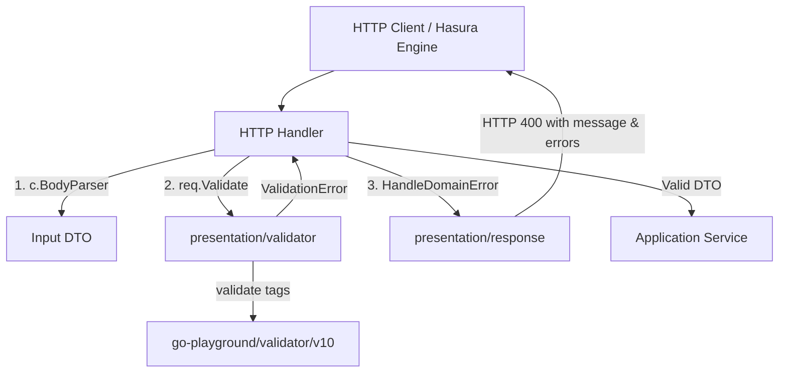

# DTO Validation Implementation Plan

> **For agentic workers:** REQUIRED SUB-SKILL: Use superpowers:subagent-driven-development to implement this plan task-by-task. Steps use checkbox (`- [ ]`) syntax for tracking.

**Goal:** Implement robust, standardized DTO validation across all application inputs using `go-playground/validator/v10`, JSON field error resolution, and seamless Hasura Action error compatibility.

**Architecture:** A presentation-layer validator utility wraps `validator.v10` to extract JSON field names, produce structured `ValidationError` responses, and unwrap to `domainerrors.ErrInvalidInput`. Input DTOs implement a `.Validate() error` method. Handlers validate immediately after binding, and the error handler returns standard 400 responses containing both a summarized `"message"` and detailed `"errors"` array.

**Architecture Diagram:**

**Tech Stack:** Go 1.24, Fiber v2, `github.com/go-playground/validator/v10`

## Global Constraints
- All input DTOs must expose a `Validate() error` method.
- Validation errors must output lowercase JSON field names (`first_name`, `email`), never Go struct names.
- `ValidationError` must implement `Unwrap() error` returning `domainerrors.ErrInvalidInput`.
- Hasura Action contract must be preserved: 400 Bad Request responses must contain `{"message": "..."}`.
- Zero dependencies on `validator.v10` inside `internal/domain`.

---

### Task 1: Validation Engine & Dependency Setup

**Files:**
- Modify: `go.mod`
- Create: `internal/infrastructure/validator/validator.go`
- Test: `internal/infrastructure/validator/validator_test.go`

**Interfaces:**
- Produces:
  - `validator.ValidateStruct(s interface{}) error`
  - `type FieldError struct { Field string; Error string }`
  - `type ValidationError struct { Errors []FieldError }`
  - `(v *ValidationError) Error() string`
  - `(v *ValidationError) Unwrap() error`

- [ ] **Step 1: Install `validator/v10` dependency**
  Run `go get github.com/go-playground/validator/v10` and `go mod vendor`.

- [ ] **Step 2: Write failing unit test for `ValidateStruct`**
  Create `internal/infrastructure/validator/validator_test.go` asserting JSON tag extraction, `required`, `email`, `min`, `max`, `gt`, and `Unwrap()` behavior.

- [ ] **Step 3: Run the test to confirm it fails**
  Run `go test ./internal/infrastructure/validator`.

- [ ] **Step 4: Implement `validator.go`**
  Create `internal/infrastructure/validator/validator.go` with JSON tag registration, `FieldError`, `ValidationError`, custom error message formatting, and `ValidateStruct`.

- [ ] **Step 5: Run tests to verify they pass**
  Run `go test -v ./internal/infrastructure/validator`.

- [ ] **Step 6: Commit**
  Commit Task 1 changes.

---

### Task 2: DTO Validation Tags & `Validate()` Methods

**Files:**
- Modify: `internal/application/dto/auth_dto.go`
- Modify: `internal/application/dto/payment_dto.go`
- Modify: `internal/application/dto/media_dto.go`
- Modify: `internal/application/dto/notification_dto.go`
- Test: `internal/application/dto/dto_test.go`

**Interfaces:**
- Consumes: `validator.ValidateStruct`
- Produces:
  - `(LoginInputDTO) Validate() error`
  - `(SignupInputDTO) Validate() error`
  - `(MeInputDTO) Validate() error`
  - `(InitializePaymentInputDTO) Validate() error`
  - `(VerifyPaymentInputDTO) Validate() error`
  - `(UploadRecipeImagesInputDTO) Validate() error`
  - `(UploadUserImageInputDTO) Validate() error`
  - `(LikeEventDataNewDTO) Validate() error`

- [ ] **Step 1: Write failing tests for DTO `.Validate()` in `dto_test.go`**
  Add test cases verifying validation rules for each DTO (empty required fields, invalid email, short username/password, negative amounts, missing nested images).

- [ ] **Step 2: Run tests to confirm they fail**
  Run `go test ./internal/application/dto`.

- [ ] **Step 3: Add `validate:"..."` tags and `Validate()` methods to all DTOs**
  Update `auth_dto.go`, `payment_dto.go`, `media_dto.go`, and `notification_dto.go`.

- [ ] **Step 4: Run tests to verify all DTO validation passes**
  Run `go test -v ./internal/application/dto`.

- [ ] **Step 5: Commit**
  Commit Task 2 changes.

---

### Task 3: Error Handling & Handler Integration

**Files:**
- Modify: `internal/presentation/response/errors.go`
- Modify: `internal/presentation/http/handlers/auth_handler.go`
- Modify: `internal/presentation/http/handlers/payment_handler.go`
- Modify: `internal/presentation/http/handlers/media_handler.go`
- Modify: `internal/presentation/http/handlers/notification_handler.go`
- Test: `internal/presentation/response/errors_test.go`

**Interfaces:**
- Consumes: `*validator.ValidationError`, `dto.Validatable`
- Produces: HTTP 400 Bad Request with `{"message": "...", "errors": [...]}`

- [x] **Step 1: Write failing test in `errors_test.go` for `ValidationError` mapping**
  Assert that passing `&validator.ValidationError` to `HandleDomainError` produces HTTP 400 with both `"message"` and `"errors"`.

- [x] **Step 2: Run test to confirm it fails**
  Run `go test ./internal/presentation/response`.

- [x] **Step 3: Update `HandleDomainError` in `internal/presentation/response/errors.go`**
  Add type assertion for `*validator.ValidationError` returning status 400 with formatted message and errors array.

- [x] **Step 4: Integrate `.Validate()` calls into all handlers**
  - `auth_handler.go`: `Login`, `Signup`, `Me`
  - `payment_handler.go`: `InitializePayment`, `VerifyPayment`
  - `media_handler.go`: `UploadRecipeImages`, `UploadUserImage`
  - `notification_handler.go`: `LikeNotification`

- [x] **Step 5: Run tests to verify handler and response behavior**
  Run `go test -v ./internal/presentation/response ./internal/presentation/http/handlers`.

- [x] **Step 6: Commit**
  Commit Task 3 changes.

---

### Task 4: Integration Verification & Regression Suite

**Files:**
- Modify: `internal/presentation/http/handlers/handlers_test.go`
- Test: All packages via `make test`

- [ ] **Step 1: Add handler validation tests in `handlers_test.go`**
  Add test cases verifying 400 responses with invalid login, signup, payment init, recipe image, user avatar, and notification requests.

- [ ] **Step 2: Run all tests across the repository**
  Run `make test`.

- [ ] **Step 3: Verify binary build**
  Run `make build` and `make clean`.

- [ ] **Step 4: Commit and finalize**
  Commit Task 4 changes.
